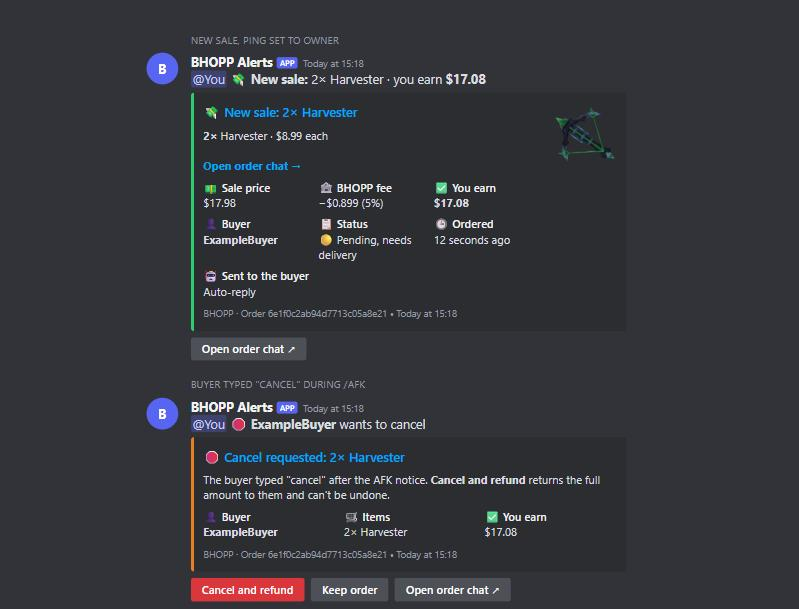

# BHOPP Improved Notifs

A Discord bot for BHOPP sellers. It pings you the moment you make a sale, and can look after
the order chat while you're busy.



It uses BHOPP's unofficial API, which can change at any time.

## What it does

- **Sale alerts** with the item picture, quantities, price, BHOPP's fee, what you earn, the
  buyer, the status and a link to the chat. Pings you, @everyone or nobody.
- **Auto-reply** in the order chat of every new sale.
- **`/afk 2h`** sends every new sale a notice with the time left. If the buyer types "cancel",
  you get Cancel and refund / Keep order buttons in Discord.
- **Thank-you message** asking for a good review once an order completes.
- **Always online** on BHOPP while the bot runs.
- Pings for disputes, cancelled orders, orders still undelivered after 10 hours, and a BHOPP
  token that is about to expire.

Everything that writes to BHOPP is **off until you turn it on**. Each automatic message goes
out once per order, even across restarts.

## Commands

Only the Discord user in `DISCORD_OWNER_ID` can use these, and replies are private.

| Command | |
|---|---|
| `/status` | Health, token expiry and every setting |
| `/alerts ping reminders` | Who a sale pings: `owner`, `everyone` or `off` |
| `/autoreply on\|off` | Auto-reply to new sales |
| `/thanks on\|off` | Thank-you message after completion |
| `/afk duration` | Away for `30m`, `2h`, `1h30m` |
| `/back` | End AFK early |
| `/cancelmode ask\|auto` | Buyer types "cancel": ask you first, or cancel and refund by itself |
| `/message kind text` | Edit a message; `default` resets it |
| `/online on\|off` | Always show as online |
| `/orders` | Open orders with chat links |
| `/stats` | Sales and earnings |
| `/testsale` | Post a sample alert (pings you at most, never @everyone) |

Messages can use `{buyer}` `{seller}` `{items}` `{total}` `{order}`, and in the AFK message
`{left}` and `{until}`.

A buyer's "cancel" only counts on a pending order that got the AFK notice, typed after it.
`auto` mode still asks you if you wrote in that chat yourself. Cancelling refunds the buyer in
full and can't be undone. On their own, buyers can only cancel 12 hours after buying.

## Setup

1. Create an application at [discord.com/developers](https://discord.com/developers/applications),
   then copy the token from **Bot**. No privileged intents are needed.
2. Invite it with the scopes `bot` and `applications.commands`. Give it View Channel, Send
   Messages, Embed Links and Read Message History in the alert channel, plus Mention Everyone
   if you want `@everyone` pings.
3. On bhopp.com press F12 and run `copy(localStorage.getItem('bhopp.token'))` in the Console.
   This token is a password for your account, and lasts 7 days.
4. Run it:

```bash
python -m venv .venv
.venv/Scripts/pip install -e ".[dev]"
cp .env.example .env
```

Fill in `.env`, then check the BHOPP token (read-only) and start the bot:

```bash
.venv/Scripts/bhopp-notifs check
```

```bash
.venv/Scripts/bhopp-notifs run
```

On its first run the bot records your open orders without alerting them. To rehearse, set
`DRY_RUN=true`: messages and cancels appear in Discord and nothing is written to BHOPP.

Run only one copy per BHOPP account.

## Railway

Pushes to `main` publish `ghcr.io/reverseddata/bhopp-improved-notifs:latest`.
[docs/RAILWAY.md](docs/RAILWAY.md) lists every setting. When the token expires, update
`BHOPP_TOKEN` in Railway; the volume keeps your orders and settings.

## Tests

```bash
.venv/Scripts/python -m pytest
```
